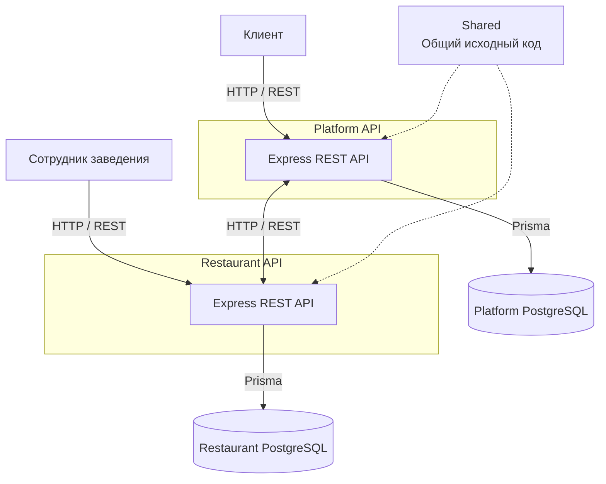

# C4 — Container Diagram

## Назначение

Диаграмма контейнеров показывает основные части Avito.Kitchen, их ответственность и способы взаимодействия.

В проекте используются два самостоятельных backend-сервиса и две отдельные базы данных.

## Контейнеры

### 1. Platform API

**Технологии:** Node.js, Express, TypeScript, Prisma.

Отвечает за взаимодействие с клиентом и бизнес-логику платформы.

Основные задачи:

- получение списка заведений;
- получение информации о заведении;
- получение меню;
- оформление заказа;
- хранение информации о заказе;
- предоставление клиенту актуального статуса заказа.

Для проверки товаров и получения статуса Platform API обращается к Restaurant API по HTTP.

### 2. Restaurant API

**Технологии:** Node.js, Express, TypeScript, Prisma.

Отвечает за данные заведения и обработку заказов.

Основные задачи:

- получение информации о заведении;
- получение меню;
- управление товарами;
- проверка товаров и их доступности;
- получение заказов;
- изменение статусов заказов.

Restaurant API является источником актуального статуса заказа.

### 3. Platform PostgreSQL

База данных платформы.

Хранит:

- информацию о заведениях;
- заказы клиентов;
- позиции заказов.

### 4. Restaurant PostgreSQL

База данных заведения.

Хранит:

- информацию о заведении;
- товары и их доступность;
- полученные заказы;
- статусы заказов.

### 5. Shared

Общий исходный код, используемый обоими backend-сервисами.

Содержит общие компоненты, например:

- конфигурацию окружения;
- обработку HTTP-ошибок;
- middleware;
- утилиты.

Shared не является отдельным запускаемым сервисом или контейнером.

## Взаимодействие контейнеров

- Клиент отправляет HTTP-запросы в Platform API.
- Platform API работает со своей базой Platform PostgreSQL.
- Platform API обращается к Restaurant API по HTTP.
- Restaurant API работает со своей базой Restaurant PostgreSQL.
- Сотрудник заведения взаимодействует с Restaurant API через его REST API.

### Основные HTTP-вызовы между сервисами

| Метод | Endpoint | Назначение |
|---|---|---|
| GET | `/menu` | Получение меню заведения |
| POST | `/products/lookup` | Проверка товаров, цен и доступности |
| POST | `/orders` | Передача нового заказа |
| GET | `/orders/:id` | Получение заказа и его актуального статуса |

## Диаграмма

## Принципы разделения

1. Каждый сервис отвечает за свою предметную область.
2. У каждого сервиса собственная база данных.
3. Сервисы не обращаются напрямую к базам данных друг друга.
4. Взаимодействие между сервисами происходит через HTTP API.
5. Идентификатор заказа одинаков в обеих базах данных, но связи между таблицами разных баз данных отсутствуют.
6. Актуальный статус заказа хранится на стороне Restaurant API. Platform API получает его при запросе заказа клиентом.

## Запуск

Оба сервиса и обе базы данных запускаются в рамках одного Docker Compose-окружения.
