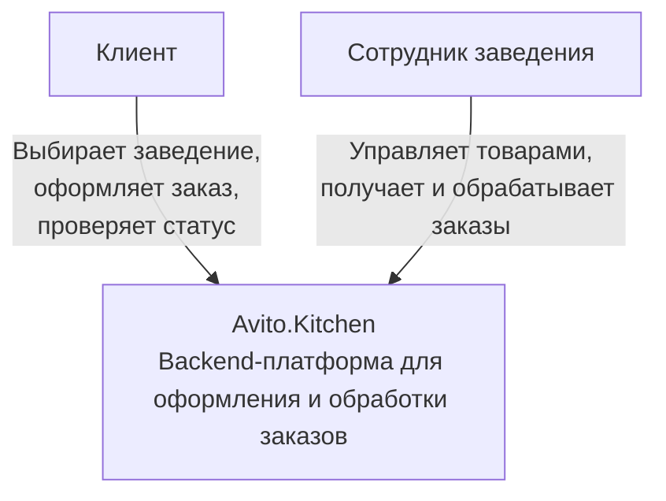

# C4 - System Context

## Назначение

Диаграмма контекста показывает Avito.Kitchen на верхнем уровне: кто взаимодействует с системой и для чего она нужна.

## Участники

- **Клиент** - выбирает заведение, просматривает меню, оформляет заказ и проверяет его статус.
- **Сотрудник заведения** - управляет товарами, просматривает поступившие заказы и изменяет их статусы.

## Система

**Avito.Kitchen** - backend-платформа для оформления и обработки заказов заведений.

Система предоставляет REST API и состоит из двух основных сервисов:

- Platform API - взаимодействие с клиентом и управление заказами на стороне платформы.
- Restaurant API - управление данными заведения, товарами и обработкой заказов.

## Диаграмма

## Границы системы

В рамках проекта реализуется backend-часть системы.

Пользовательские интерфейсы клиента и сотрудника, авторизация и оплата заказов в MVP не входят.
